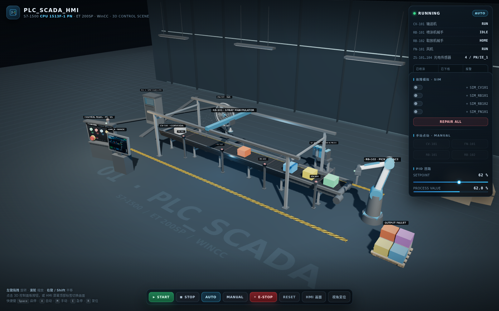

# PLC_SCADA_HMI · 3D Control Scene

用 **TiaLink** 读取开源项目 [`rassulz/multirobot_painting_control_system`](https://github.com/rassulz/multirobot_painting_control_system) 中的 TIA Portal 项目 `PLC_SCADA_HMI`，再用 **three.js** 程序化重建为可交互的 3D 产线。

- **在线预览**：https://tia-forge.github.io/plc-scada-hmi-3d/
- **单文件版本**：[`PLC_SCADA_HMI_3D.html`](PLC_SCADA_HMI_3D.html)（约 680 KB，three.js 已内联）



## 项目内容

- **CV-101** 输送机：动态皮带、滚筒、驱动电机
- **RB-101** 喷涂龙门：轨道、横梁、喷嘴、喷雾粒子
- **RB-102** 取放机械手：两连杆 IK、夹爪、托盘码垛
- **FN-101** 风机：旋转叶片与气流粒子
- **ZS-101…ZS-104** 光电传感器：光束与触发指示
- **PS101–PS104 / ES101** 操作面板：可按的 3D 按钮
- **HMI_1**：MAIN PART / PID / ERROR STATUS 三个画面
- **PLC_1 · CPU 1513F-1 PN** 控制柜与 **ET 200SP · IM 155-6 PN ST**
- 自动/手动模式、故障模拟、急停、PID、喷涂与下线计数

场景覆盖 TiaLink 读出的设备、变量、程序块、报警和 HMI 画面；它是一张可讨论的“立体图”，不是精确的数字孪生，也不是 TIA/PLCSIM 的替代品。TiaLink 在整个流程中只读，不会写回项目。

## 运行

```bash
# 直接打开，不需要服务器
open PLC_SCADA_HMI_3D.html      # macOS
xdg-open PLC_SCADA_HMI_3D.html  # Linux
start PLC_SCADA_HMI_3D.html     # Windows
```

需要支持 WebGL 的现代浏览器。运行时没有 CDN、外部图片、模型或字体。

## 交互

- 左键拖拽旋转，滚轮缩放，右键 / Shift 拖拽平移
- 工具栏或 3D 面板：START / STOP / AUTO / MANUAL / E-STOP / RESET
- HMI 屏幕：点顶部标签切换 MAIN PART / PID / ERROR STATUS
- 右侧面板：注入 `SIM_*` 故障、Repair all、手动点动、PID 设定值
- 快捷键：`Space` 启停、`A` 自动、`M` 手动、`E` 急停、`R` 复位、`H` 切 HMI
- 地址后加 `#auto` 自动开始演示

## 目录

```text
PLC_SCADA_HMI_3D.html    # 最终单文件（three.js 内联）
index.html               # GitHub Pages 入口，重定向到上面的单文件
images/                  # README 配图
scene3d/
  app.js                 # 场景、仿真、交互源码
  template.html          # HTML/CSS 模板
  three.min.js           # three.js r150.1 UMD（MIT）
  build.py               # 重新打包成单文件
  README.md              # 场景源码说明
```

## 重新构建

```bash
python3 scene3d/build.py
```

`build.py` 会把 `scene3d/app.js`、`scene3d/template.html` 和内联的 three.js 合并成根目录的 `PLC_SCADA_HMI_3D.html`。

## 数据来源

- 来源：[`rassulz/multirobot_painting_control_system`](https://github.com/rassulz/multirobot_painting_control_system)（MIT License）
- 项目：`PLC_SCADA_HMI`（TIA Portal V19）
- 设备：S7-1500 / CPU 1513F-1 PN、ET 200SP / IM 155-6 PN ST、HMI_1、PC-System_1
- 块：OB1 `Main`、FB2 `Auto_mode`、FB3 `Manu_mode`、两个实例 DB
- 变量：51 个 PLC 变量，两张变量表
- 画面：`Main Part`、`Error_Status`、`PID`
- 网络：PROFINET `PN/IE_1`，PLC `172.31.17.15`

3D 场景是对其中 PLC/HMI 数据的程序化可视化，机械结构做了简化，不代表原始设备的精确比例或节拍。原始项目文件不在本仓库中；本仓库只包含可视化代码和截图。

## 第三方

- [three.js](https://threejs.org/) r150.1 — MIT License，Copyright 2010-2023 Three.js Authors。
- [multirobot_painting_control_system](https://github.com/rassulz/multirobot_painting_control_system) — MIT License，原始 TIA Portal 项目与 HMI 画面来源。
- 其余场景几何、纹理、标签和粒子贴图均由本项目代码程序化生成。
